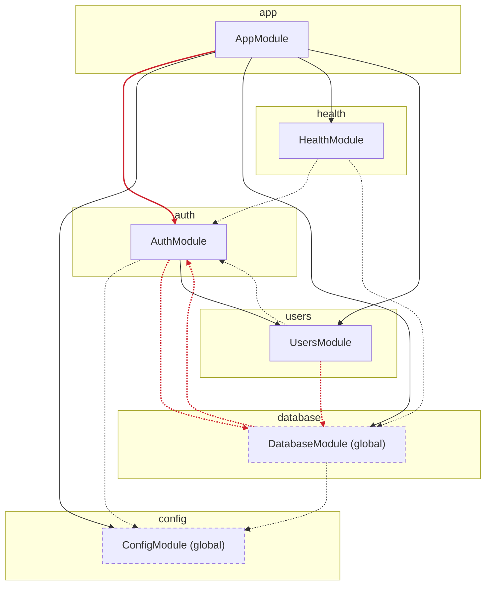

# nest-arch-guard

English | [ภาษาไทย](README.th.md)

[](https://github.com/nuttakulsv/nest-arch-guard/actions/workflows/ci.yml)
[](https://www.npmjs.com/package/nest-arch-guard)
[](LICENSE)


Architecture tests for NestJS that read your `@Module()` metadata, not just your import statements. Fail CI when one module reaches into another module's internals, catch module cycles that `forwardRef` is hiding, and keep the module diagram generated from the code so it never goes stale.


```bash
npx nest-arch-guard          # module cycles and public APIs, no config needed
npx nest-arch-guard init     # write arch.config.ts from the structure you have today
npx nest-arch-guard diagram  # module diagram into docs/architecture.md
```

## What it looks like

The output above is a real run against [`test/fixtures/shop`](test/fixtures/shop), a small Nest app with orders, payments and users modules and a few mistakes planted on purpose. A few of them are worth a closer look, because a file-level tool can't see them:

```
onlyThroughPublicApi
  error  src/payments/payments.service.ts:7
         PaymentsService injects OrdersRepository, which OrdersModule provides but does not export

noCycles
  error  src/orders/orders.module.ts:8
         Module cycle: OrdersModule → PaymentsModule → OrdersModule (held together with forwardRef)
```

The first one would also blow up when the app starts, but only once the app actually starts. Here you get it in the pull request, with the file and line. The second one runs fine. `forwardRef` exists to make that cycle work, and that's exactly why nobody notices that two modules can no longer be separated.

`nest-arch-guard diagram` draws the same project. Solid arrows are `imports: [...]`, dashed arrows are code that uses another module without importing it (usually through a global module), and red arrows break a rule:


## Why

In a Nest app the module is the unit of architecture. It decides what is private (providers) and what other modules may use (exports). The compiler doesn't care, though. Any file can import any other file, so after a few months `users` reads `orders` repositories directly, a helper deep inside `payments` is used everywhere, and the folder structure in the README is fiction.

Tools that check imports by folder help, but they don't know what a Nest module exports, which module a provider belongs to, or that `forwardRef` is papering over a cycle. nest-arch-guard reads the module metadata with the TypeScript compiler, joins it with the file import graph, and checks rules that talk about modules:

- Code in another module may only use a module's module file, its `index.ts`, the providers it exports, and contract files like DTOs and enums.
- No cycles between modules or between files.
- Boundaries you name (`orders`, `orders-domain`, `shared`) may only depend on the boundaries you allow.
- Controllers call services, services call repositories, never upward.
- Pure domain code doesn't import `@nestjs/*` or your ORM.

## Tried on a real project

This is [nestjs-starter-production](https://github.com/nuttakulsv/nestjs-starter-production), a small, tidy codebase. With no config at all:

```console
$ npx nest-arch-guard
No arch.config found, checking cycles and module public APIs only. Run `nest-arch-guard init` for more.

nest-arch-guard  26 files, 6 Nest modules, 421 ms

onlyThroughPublicApi
  error  src/app.module.ts:9
         AppModule imports src/auth/auth.controller.ts, which is internal to AuthModule
  error  src/auth/auth.service.ts:14
         AuthModule imports src/database/schema.ts, which is internal to DatabaseModule
  error  src/database/seed.ts:2
         DatabaseModule imports src/auth/password.ts, which is internal to AuthModule
  error  src/users/users.service.ts:5
         UsersModule imports src/database/schema.ts, which is internal to DatabaseModule

4 errors, 0 warnings
```

All four are real decisions somebody made. The app module reaches into the auth controller to scope a rate limit, and services import the Drizzle schema straight from the database folder. You might keep them, move the schema behind `database/index.ts`, or allow it in the config. The point is that it is now a decision and not an accident. Adopting the tool doesn't mean fixing them first:

```console
$ npx nest-arch-guard init
Created arch.config.ts with 7 boundaries from 6 Nest modules.

4 existing violations. To adopt the rules without fixing them all today:
  npx nest-arch-guard --update-baseline

Then tighten the rules in the config and add `npx nest-arch-guard` to CI.

$ npx nest-arch-guard --update-baseline
Wrote 4 violations to arch-baseline.json

$ npx nest-arch-guard
nest-arch-guard  26 files, 6 Nest modules, 342 ms

0 errors, 0 warnings, 4 baselined
```

From here on, CI only fails on new violations. On [brocoders/nestjs-boilerplate](https://github.com/brocoders/nestjs-boilerplate) (171 files, 26 modules) a full check takes about 0.6 s on an Apple M2.

## Install

```bash
npm install --save-dev nest-arch-guard
```

Node.js 20 or newer. The package brings its own TypeScript 6 compiler for parsing, so it works whatever TypeScript version your project uses. Your `tsconfig.json` is read for `paths`, `baseUrl` and module resolution, so `@app/*` aliases and ESM `.js` suffixes resolve correctly.

## Configuration

`init` writes a starting point from your current structure. A fuller example:

```ts
// arch.config.ts
import { defineConfig } from 'nest-arch-guard'

export default defineConfig({
  boundaries: {
    app: 'src/*',
    shared: 'src/shared',
    orders: 'src/orders',
    'orders-domain': 'src/orders/domain',
    payments: { modules: ['PaymentsModule'] },
    users: 'src/users',
  },
  rules: {
    noCycles: true,
    onlyThroughPublicApi: true,
    noDeepImports: true,
    dependencies: [
      { from: 'users', deny: ['orders', 'payments'] },
      { from: 'orders-domain', allow: ['shared'], message: 'Keep the domain free of other features' },
    ],
    layers: {
      order: [
        { name: 'controller', files: '**/*.controller.ts' },
        { name: 'service', files: '**/*.service.ts' },
        { name: 'repository', files: '**/*.repository.ts' },
      ],
    },
    forbidden: [{ from: 'orders-domain', packages: ['@nestjs/*', 'typeorm'] }],
  },
})
```

`arch.config.ts`, `.mts`, `.js`, `.mjs` and `.json` are all picked up from the project root. TypeScript configs are compiled on the fly, no `ts-node` needed.

| Option       | Default                                                            | Meaning                                                                                                                                                                                                                                           |
| ------------ | ------------------------------------------------------------------ | ------------------------------------------------------------------------------------------------------------------------------------------------------------------------------------------------------------------------------------------------- |
| `boundaries` | one per Nest module                                                | Named groups of code. A string or array is a path or glob; `src/orders` means `src/orders/**`. `{ modules: [...] }` groups by Nest module class name. When several match, the most specific path wins, so `src/orders/domain` beats `src/orders`. |
| `rules`      | `noCycles` and `onlyThroughPublicApi` when there is no config file | See below. With a config file only the rules you list run.                                                                                                                                                                                        |
| `project`    | `tsconfig.json`                                                    | tsconfig used to find files and resolve imports                                                                                                                                                                                                   |
| `exclude`    | spec, test, e2e files, `test/**`, `dist/**`                        | Globs left out of the analysis                                                                                                                                                                                                                    |
| `baseline`   | `arch-baseline.json`                                               | Accepted violations                                                                                                                                                                                                                               |
| `diagram`    | `docs/architecture.md`                                             | Where `diagram` writes                                                                                                                                                                                                                            |

Every rule accepts `severity: 'error' | 'warn'`. Warnings are reported but don't fail the run.

## Rules

| Rule                   | What it checks                                                                                                                                                                                                                                                                                                                                                                                                                                                                                                  |
| ---------------------- | --------------------------------------------------------------------------------------------------------------------------------------------------------------------------------------------------------------------------------------------------------------------------------------------------------------------------------------------------------------------------------------------------------------------------------------------------------------------------------------------------------------- |
| `onlyThroughPublicApi` | Code outside a Nest module may only import the module file, the module's `index.ts`, the files that declare its exported providers, and contract files (`*.dto.ts`, `dto/`, `*.enum.ts`, `*.types.ts`, `*.interface.ts`, `*.constants.ts`, `*.decorator.ts`, `decorators.ts`). Also flags constructor injection of a provider that another module provides but doesn't export. Options: `files` replaces the contract file globs (`[]` for strict), `types: true` also checks imports that bring in only types. |
| `noCycles`             | Cycles between Nest modules (`forwardRef` is called out) and between files. Imports that bring in only types are ignored, since they disappear at runtime. Options: `modules`, `files` (both on by default).                                                                                                                                                                                                                                                                                                    |
| `dependencies`         | `from` boundaries may only use boundaries in `allow`, and never those in `deny`. `"*"` matches any boundary.                                                                                                                                                                                                                                                                                                                                                                                                    |
| `layers`               | Files are assigned to layers by glob, top to bottom. A layer may use layers below it, never above. `strict: true` also forbids skipping a layer.                                                                                                                                                                                                                                                                                                                                                                |
| `noDeepImports`        | When a boundary has an `index.ts`, other boundaries must import through it.                                                                                                                                                                                                                                                                                                                                                                                                                                     |
| `forbidden`            | Packages a boundary may not import, by name or glob (`@nestjs/*`).                                                                                                                                                                                                                                                                                                                                                                                                                                              |

`dependencies` and `layers` count type-only imports too, because a type from another feature is still coupling.

A module whose folder contains other modules and sits under no module (usually `AppModule` in `src/`) only owns the files directly in its folder. Other files belong to the closest module folder above them. A module nested inside another module's folder, like a persistence module under `users/infrastructure/`, is treated as part of that feature for `onlyThroughPublicApi`.

## Adopting it in an existing codebase

- `npx nest-arch-guard --update-baseline` records every current violation in `arch-baseline.json`. Commit it. Later runs only fail on violations that aren't in the file, and tell you when baselined ones have been fixed so you can shrink it.
- `--no-baseline` shows everything, for a cleanup session.
- For a single line you have decided to keep, put a comment above it:

  ```ts
  // arch-guard-ignore-next-line moving the fee table into users is planned for Q3
  import { PAYMENT_FEE } from '../payments/payments.internal.js'
  ```

Baseline entries are keyed by rule and files, not line numbers, so moving code around doesn't break them.

## In CI

```yaml
# .github/workflows/architecture.yml
name: Architecture
on: [pull_request]
jobs:
  check:
    runs-on: ubuntu-latest
    steps:
      - uses: actions/checkout@v4
      - uses: actions/setup-node@v4
        with:
          node-version: 22
      - run: npm ci
      - run: npx nest-arch-guard
      - run: npx nest-arch-guard diagram --check
```

Inside GitHub Actions the report also prints workflow annotations, so violations show up on the changed lines of the pull request. `--format github` prints only the annotations, `--format json` gives a machine-readable report. Exit codes: `0` clean, `1` violations with severity `error`, `2` bad usage or config.

## Diagrams

`nest-arch-guard diagram` writes a Mermaid flowchart between two markers in `docs/architecture.md`, so you can keep your own notes around it. GitHub renders Mermaid in markdown, so the diagram shows up in the repo. Add `--svg docs/architecture.svg` for a standalone image, and run `diagram --check` in CI to fail when someone changes the modules without regenerating it. Red edges include baselined violations, because the diagram shows the code as it is.

This is the diagram for nestjs-starter-production, generated by the tool and pasted as is:



## Compared with other tools

These are good tools and you may want one of them next to this one.

|                                                                                    | Works on                                        | Knows Nest modules                                                 | Editor feedback     | Notes                                                               |
| ---------------------------------------------------------------------------------- | ----------------------------------------------- | ------------------------------------------------------------------ | ------------------- | ------------------------------------------------------------------- |
| [dependency-cruiser](https://github.com/sverweij/dependency-cruiser)               | File and folder import graph                    | No                                                                 | No                  | Very flexible rule language, many output formats, any JS/TS project |
| [eslint-plugin-boundaries](https://github.com/javierbrea/eslint-plugin-boundaries) | File imports, element types by pattern          | No                                                                 | Yes, through ESLint | Good if you want feedback while typing                              |
| [Nx module boundaries](https://nx.dev/features/enforce-module-boundaries)          | Projects and libraries, by tag                  | No                                                                 | Yes, through ESLint | Needs an Nx workspace split into libraries                          |
| nest-arch-guard                                                                    | Nest module metadata plus the file import graph | Yes: providers, exports, injections, `forwardRef`, dynamic modules | No                  | NestJS only, generates diagrams from the code                       |

If your boundaries are folders and you already use one of the first two, keep it. nest-arch-guard is for the rules that need to know what a Nest module exports.

## FAQ and limitations

**How much of the module metadata can it read?** Array literals, spreads, `const` arrays and objects, both branches of a ternary, `forRoot()`/`forFeature()`/`register()` calls, `forwardRef(() => X)`, barrel re-exports, and static methods that return `{ module: X, imports, providers, exports }`. Metadata built in loops or from runtime values is only partly followed.

**What about modules from libraries like `TypeOrmModule`?** They are recorded as imports but left out of rules and diagrams. Only modules in your project are checked.

**Monorepos?** Run it once per app with `--cwd apps/api` or `-p apps/api/tsconfig.app.json`.

**Does it support TypeScript 7?** Your project can use any version. The analyzer ships with TypeScript 6, because TypeScript 7's native compiler doesn't expose the same JavaScript API yet.

**Files that belong to no module**, like `src/common`, aren't covered by `onlyThroughPublicApi`. Give them a boundary and use `dependencies`.

**No editor integration yet.** Results come from the CLI and CI.

## Contributing

Bug reports with a small reproduction are the most useful thing you can send. A failing fixture under `test/fixtures` is even better. See [CONTRIBUTING.md](CONTRIBUTING.md). Issues are welcome in English or Thai.

## License

[MIT](LICENSE)
