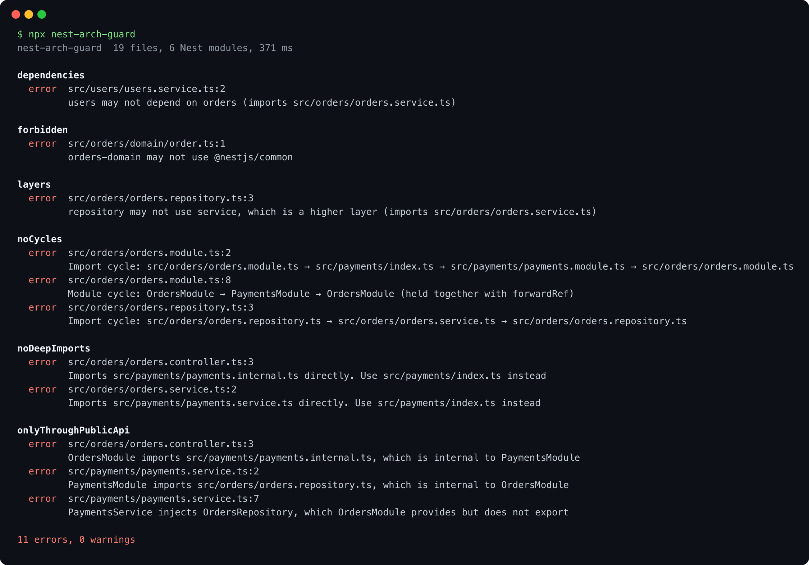
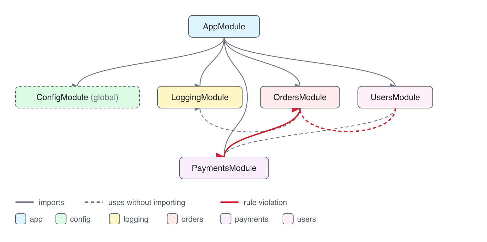
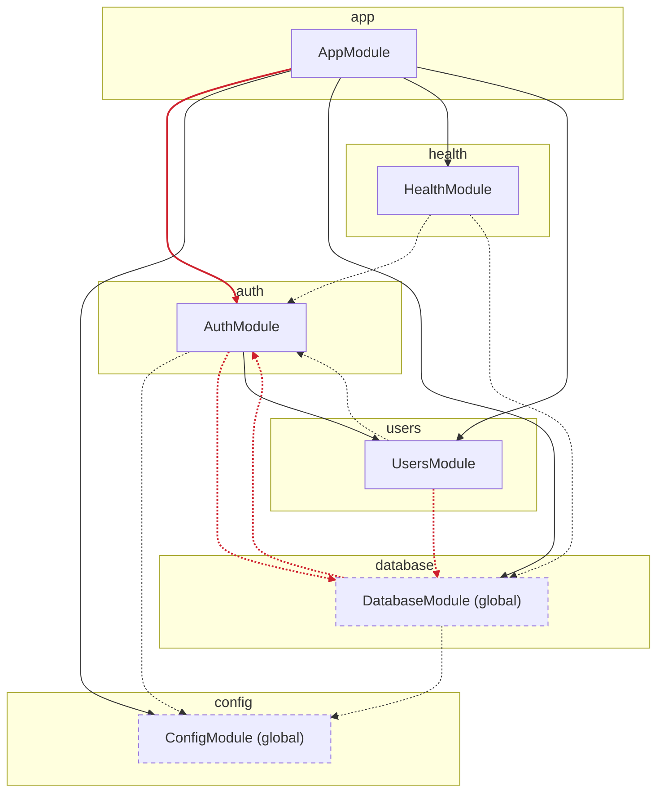

# nest-arch-guard

[English](README.md) | ภาษาไทย

[](https://github.com/nuttakulsv/nest-arch-guard/actions/workflows/ci.yml)
[](https://www.npmjs.com/package/nest-arch-guard)
[](LICENSE)


เครื่องมือเขียน architecture test สำหรับ NestJS ที่อ่าน metadata ใน `@Module()` ด้วย ไม่ได้ดูแค่บรรทัด import ใช้ให้ CI fail เมื่อ module หนึ่งล้วงเข้าไปใช้ของข้างในอีก module, จับ module ที่วนกันอยู่โดยมี `forwardRef` บังไว้, และสร้าง diagram ของ module จากโค้ดจริงทุกครั้ง diagram จึงไม่มีวันเก่า



```bash
npx nest-arch-guard          # ตรวจ module ที่วนกันและ public API ของแต่ละ module ไม่ต้องมี config
npx nest-arch-guard init     # เขียน arch.config.ts จากโครงสร้างที่มีอยู่ตอนนี้
npx nest-arch-guard diagram  # วาด diagram ของ module ลง docs/architecture.md
```

## หน้าตาเป็นยังไง

ภาพด้านบนคือผลรันจริงกับ [`test/fixtures/shop`](test/fixtures/shop) ซึ่งเป็นแอป Nest เล็ก ๆ มี module orders, payments, users และฝังจุดผิดไว้หลายจุด มีอยู่สองข้อที่เครื่องมือตรวจระดับไฟล์มองไม่เห็น

```
onlyThroughPublicApi
  error  src/payments/payments.service.ts:7
         PaymentsService injects OrdersRepository, which OrdersModule provides but does not export

noCycles
  error  src/orders/orders.module.ts:8
         Module cycle: OrdersModule → PaymentsModule → OrdersModule (held together with forwardRef)
```

ข้อแรกจริง ๆ แอปก็จะพังตอนสตาร์ตอยู่แล้ว แต่ต้องรอให้แอปสตาร์ตก่อนถึงจะรู้ ตัวนี้บอกตั้งแต่ใน pull request พร้อมชื่อไฟล์และบรรทัด ส่วนข้อสองรันได้ปกติ เพราะ `forwardRef` มีไว้ให้ cycle แบบนี้ทำงานได้ และนั่นแหละคือเหตุผลที่ไม่มีใครสังเกตว่าสอง module นี้แยกออกจากกันไม่ได้แล้ว

`nest-arch-guard diagram` วาดโปรเจกต์เดียวกันออกมาแบบนี้ เส้นทึบคือ `imports: [...]` เส้นประคือโค้ดที่ใช้ของอีก module โดยไม่ได้ import module นั้น (ส่วนใหญ่ผ่าน global module) และเส้นแดงคือจุดที่ผิดกฎ



## ทำไมถึงทำตัวนี้

ในแอป Nest หน่วยของ architecture คือ module มันเป็นตัวกำหนดว่าอะไรเป็นของส่วนตัว (providers) และอะไรให้ module อื่นใช้ได้ (exports) แต่ compiler ไม่ได้สนใจเรื่องนี้ ไฟล์ไหนก็ import ไฟล์ไหนได้ ผ่านไปไม่กี่เดือน `users` ก็ไปอ่าน repository ของ `orders` ตรง ๆ, helper ที่อยู่ลึก ๆ ใน `payments` ถูกเรียกใช้ทั่วโปรเจกต์ และโครงสร้างโฟลเดอร์ที่เขียนไว้ใน README ก็เหลือแค่ในเอกสาร

เครื่องมือที่ตรวจ import ตามโฟลเดอร์ช่วยได้ระดับหนึ่ง แต่มันไม่รู้ว่า Nest module นั้น export อะไร provider ตัวนี้เป็นของ module ไหน หรือมี `forwardRef` ปิด cycle ไว้ nest-arch-guard อ่าน metadata ของ module ด้วย TypeScript compiler แล้วรวมกับ graph ของ import ระดับไฟล์ จากนั้นตรวจกฎที่พูดถึง module ได้ตรง ๆ เช่น

- โค้ดใน module อื่นใช้ได้แค่ไฟล์ module, `index.ts`, provider ที่ export ไว้ และไฟล์ที่เป็นสัญญากลางอย่าง DTO หรือ enum
- ห้ามมี cycle ทั้งระดับ module และระดับไฟล์
- boundary ที่ตั้งชื่อไว้ (`orders`, `orders-domain`, `shared`) ใช้ได้เฉพาะ boundary ที่อนุญาต
- controller เรียก service, service เรียก repository ห้ามย้อนขึ้น
- โค้ด domain ล้วน ๆ ห้าม import `@nestjs/*` หรือ ORM

## ลองกับโปรเจกต์จริง

นี่คือ [nestjs-starter-production](https://github.com/nuttakulsv/nestjs-starter-production) ซึ่งเป็นโปรเจกต์เล็กและค่อนข้างเรียบร้อย รันแบบไม่มี config เลย

```console
$ npx nest-arch-guard
No arch.config found, checking cycles and module public APIs only. Run `nest-arch-guard init` for more.

nest-arch-guard  26 files, 6 Nest modules, 421 ms

onlyThroughPublicApi
  error  src/app.module.ts:9
         AppModule imports src/auth/auth.controller.ts, which is internal to AuthModule
  error  src/auth/auth.service.ts:14
         AuthModule imports src/database/schema.ts, which is internal to DatabaseModule
  error  src/database/seed.ts:2
         DatabaseModule imports src/auth/password.ts, which is internal to AuthModule
  error  src/users/users.service.ts:5
         UsersModule imports src/database/schema.ts, which is internal to DatabaseModule

4 errors, 0 warnings
```

ทั้งสี่ข้อเป็นการตัดสินใจที่มีคนเลือกไว้จริง ๆ app module ล้วงเข้าไปใช้ auth controller เพื่อกำหนด rate limit ส่วน service ก็ import schema ของ Drizzle ตรงจากโฟลเดอร์ database จะเก็บไว้แบบนี้ต่อ, ย้าย schema ไปไว้หลัง `database/index.ts` หรือเขียนอนุญาตไว้ใน config ก็ได้ ประเด็นคือตอนนี้มันกลายเป็นเรื่องที่ตั้งใจเลือก ไม่ใช่เรื่องบังเอิญ และไม่ต้องแก้ให้หมดก่อนถึงจะเริ่มใช้ได้

```console
$ npx nest-arch-guard init
Created arch.config.ts with 7 boundaries from 6 Nest modules.

4 existing violations. To adopt the rules without fixing them all today:
  npx nest-arch-guard --update-baseline

Then tighten the rules in the config and add `npx nest-arch-guard` to CI.

$ npx nest-arch-guard --update-baseline
Wrote 4 violations to arch-baseline.json

$ npx nest-arch-guard
nest-arch-guard  26 files, 6 Nest modules, 342 ms

0 errors, 0 warnings, 4 baselined
```

หลังจากนี้ CI จะ fail เฉพาะเมื่อมีจุดผิดใหม่เพิ่มเข้ามา ลองกับ [brocoders/nestjs-boilerplate](https://github.com/brocoders/nestjs-boilerplate) (171 ไฟล์, 26 module) ตรวจทั้งโปรเจกต์ใช้เวลาประมาณ 0.6 วินาทีบน Apple M2

## ติดตั้ง

```bash
npm install --save-dev nest-arch-guard
```

ต้องใช้ Node.js 20 ขึ้นไป ตัวแพ็กเกจมี TypeScript 6 มาในตัวสำหรับ parse โค้ด โปรเจกต์จะใช้ TypeScript เวอร์ชันไหนก็ได้ และจะอ่าน `tsconfig.json` เพื่อเอา `paths`, `baseUrl` และวิธี resolve module มาใช้ alias อย่าง `@app/*` หรือ import แบบ ESM ที่ลงท้าย `.js` จึง resolve ได้ถูกต้อง

## การตั้งค่า

`init` จะเขียนจุดเริ่มต้นให้จากโครงสร้างที่มีอยู่ ตัวอย่างแบบครบกว่านั้น

```ts
// arch.config.ts
import { defineConfig } from 'nest-arch-guard'

export default defineConfig({
  boundaries: {
    app: 'src/*',
    shared: 'src/shared',
    orders: 'src/orders',
    'orders-domain': 'src/orders/domain',
    payments: { modules: ['PaymentsModule'] },
    users: 'src/users',
  },
  rules: {
    noCycles: true,
    onlyThroughPublicApi: true,
    noDeepImports: true,
    dependencies: [
      { from: 'users', deny: ['orders', 'payments'] },
      { from: 'orders-domain', allow: ['shared'], message: 'Keep the domain free of other features' },
    ],
    layers: {
      order: [
        { name: 'controller', files: '**/*.controller.ts' },
        { name: 'service', files: '**/*.service.ts' },
        { name: 'repository', files: '**/*.repository.ts' },
      ],
    },
    forbidden: [{ from: 'orders-domain', packages: ['@nestjs/*', 'typeorm'] }],
  },
})
```

หาไฟล์ `arch.config.ts`, `.mts`, `.js`, `.mjs` และ `.json` ที่ root ของโปรเจกต์ให้เอง config ที่เป็น TypeScript จะถูกคอมไพล์ตอนรัน ไม่ต้องลง `ts-node`

| Option       | ค่าเริ่มต้น                                                      | ความหมาย                                                                                                                                                                                                                                                         |
| ------------ | ---------------------------------------------------------------- | ---------------------------------------------------------------------------------------------------------------------------------------------------------------------------------------------------------------------------------------------------------------- |
| `boundaries` | หนึ่ง boundary ต่อหนึ่ง Nest module                              | กลุ่มของโค้ดที่ตั้งชื่อไว้ ถ้าเป็น string หรือ array คือ path หรือ glob โดย `src/orders` หมายถึง `src/orders/**` ส่วน `{ modules: [...] }` คือจัดกลุ่มตามชื่อคลาสของ Nest module ถ้าตรงหลายอัน path ที่เจาะจงกว่าจะชนะ เช่น `src/orders/domain` ชนะ `src/orders` |
| `rules`      | ถ้าไม่มีไฟล์ config จะเปิด `noCycles` กับ `onlyThroughPublicApi` | ดูหัวข้อถัดไป ถ้ามีไฟล์ config จะรันเฉพาะกฎที่เขียนไว้                                                                                                                                                                                                           |
| `project`    | `tsconfig.json`                                                  | tsconfig ที่ใช้หาไฟล์และ resolve import                                                                                                                                                                                                                          |
| `exclude`    | ไฟล์ spec, test, e2e, `test/**`, `dist/**`                       | glob ของไฟล์ที่ไม่เอามาวิเคราะห์                                                                                                                                                                                                                                 |
| `baseline`   | `arch-baseline.json`                                             | รายการจุดผิดที่ยอมรับไว้ก่อน                                                                                                                                                                                                                                     |
| `diagram`    | `docs/architecture.md`                                           | ไฟล์ที่คำสั่ง `diagram` เขียนลง                                                                                                                                                                                                                                  |

ทุกกฎใส่ `severity: 'error' | 'warn'` ได้ ถ้าเป็น warning จะรายงานแต่ไม่ทำให้ fail

## กฎที่มี

| กฎ                     | ตรวจอะไร                                                                                                                                                                                                                                                                                                                                                                                                                                                              |
| ---------------------- | --------------------------------------------------------------------------------------------------------------------------------------------------------------------------------------------------------------------------------------------------------------------------------------------------------------------------------------------------------------------------------------------------------------------------------------------------------------------- |
| `onlyThroughPublicApi` | โค้ดนอก Nest module import ได้แค่ไฟล์ module, `index.ts` ของ module, ไฟล์ที่ประกาศ provider ที่ export ไว้ และไฟล์สัญญากลาง (`*.dto.ts`, `dto/`, `*.enum.ts`, `*.types.ts`, `*.interface.ts`, `*.constants.ts`, `*.decorator.ts`, `decorators.ts`) และจับการ inject ผ่าน constructor ไปยัง provider ที่ module อื่นมีแต่ไม่ได้ export ด้วย option: `files` ใช้แทนรายการไฟล์สัญญากลาง (ใส่ `[]` ถ้าอยากเข้มสุด) และ `types: true` ให้ตรวจ import ที่ดึงมาแค่ type ด้วย |
| `noCycles`             | cycle ระหว่าง Nest module (บอกด้วยถ้ามี `forwardRef`) และระหว่างไฟล์ ไม่นับ import ที่ดึงมาแค่ type เพราะหายไปตอนรัน option: `modules`, `files` (เปิดทั้งคู่เป็นค่าเริ่มต้น)                                                                                                                                                                                                                                                                                          |
| `dependencies`         | boundary ใน `from` ใช้ได้เฉพาะ boundary ใน `allow` และห้ามใช้ที่อยู่ใน `deny` ส่วน `"*"` หมายถึงทุก boundary                                                                                                                                                                                                                                                                                                                                                          |
| `layers`               | จัดไฟล์เป็นชั้นตาม glob เรียงจากบนลงล่าง ชั้นบนใช้ชั้นล่างได้ ห้ามย้อนขึ้น ถ้าใส่ `strict: true` จะห้ามข้ามชั้นด้วย                                                                                                                                                                                                                                                                                                                                                   |
| `noDeepImports`        | ถ้า boundary ไหนมี `index.ts` boundary อื่นต้อง import ผ่านไฟล์นั้น                                                                                                                                                                                                                                                                                                                                                                                                   |
| `forbidden`            | แพ็กเกจที่ boundary นั้นห้าม import ระบุเป็นชื่อหรือ glob ก็ได้ (`@nestjs/*`)                                                                                                                                                                                                                                                                                                                                                                                         |

`dependencies` กับ `layers` นับ import ที่เป็น type อย่างเดียวด้วย เพราะใช้ type ของ feature อื่นก็ยังเป็นการผูกกันอยู่ดี

module ที่โฟลเดอร์มี module อื่นอยู่ข้างใน และไม่ได้อยู่ใต้ module ไหนเลย (ส่วนใหญ่คือ `AppModule` ใน `src/`) จะเป็นเจ้าของแค่ไฟล์ที่อยู่ในโฟลเดอร์ตัวเองโดยตรง ไฟล์อื่น ๆ จะเป็นของ module ที่โฟลเดอร์อยู่ใกล้ที่สุดด้านบน ส่วน module ที่ซ้อนอยู่ในโฟลเดอร์ของอีก module เช่น persistence module ใน `users/infrastructure/` จะนับเป็นส่วนหนึ่งของ feature นั้นในกฎ `onlyThroughPublicApi`

## เริ่มใช้กับโปรเจกต์ที่มีอยู่แล้ว

- `npx nest-arch-guard --update-baseline` จะเก็บจุดผิดทั้งหมดที่มีตอนนี้ลง `arch-baseline.json` ให้ commit ไฟล์นี้ไว้ รอบต่อไปจะ fail เฉพาะจุดผิดที่ไม่อยู่ในไฟล์ และจะบอกเมื่อมีจุดในไฟล์ที่ถูกแก้ไปแล้ว จะได้ลบออกจาก baseline
- `--no-baseline` แสดงทุกจุด เหมาะกับตอนนั่งเคลียร์
- ถ้ามีบรรทัดไหนตัดสินใจแล้วว่าจะเก็บไว้ ให้ใส่ comment ไว้บรรทัดก่อนหน้า

  ```ts
  // arch-guard-ignore-next-line moving the fee table into users is planned for Q3
  import { PAYMENT_FEE } from '../payments/payments.internal.js'
  ```

baseline เก็บตามกฎและชื่อไฟล์ ไม่ได้เก็บเลขบรรทัด ย้ายโค้ดไปมาก็ยังใช้ได้

## ใส่ใน CI

```yaml
# .github/workflows/architecture.yml
name: Architecture
on: [pull_request]
jobs:
  check:
    runs-on: ubuntu-latest
    steps:
      - uses: actions/checkout@v4
      - uses: actions/setup-node@v4
        with:
          node-version: 22
      - run: npm ci
      - run: npx nest-arch-guard
      - run: npx nest-arch-guard diagram --check
```

ถ้ารันใน GitHub Actions รายงานจะพิมพ์ workflow annotation ด้วย จุดผิดจึงไปขึ้นตรงบรรทัดที่แก้ใน pull request เลย `--format github` พิมพ์แค่ annotation ส่วน `--format json` ได้รายงานแบบที่เครื่องอ่านได้ exit code: `0` ไม่มีปัญหา, `1` มีจุดผิดที่เป็น `error`, `2` ใช้คำสั่งผิดหรือ config ผิด

## Diagram

`nest-arch-guard diagram` จะเขียน flowchart ของ Mermaid ลงระหว่าง marker สองตัวใน `docs/architecture.md` ส่วนอื่นของไฟล์จึงเขียนโน้ตเองได้ GitHub แสดง Mermaid ใน markdown ให้อยู่แล้ว diagram จึงขึ้นใน repo ทันที ถ้าอยากได้รูปแยกให้เพิ่ม `--svg docs/architecture.svg` และให้ CI รัน `diagram --check` เพื่อ fail เมื่อมีคนแก้ module แล้วไม่ได้สร้าง diagram ใหม่ เส้นแดงรวมจุดที่อยู่ใน baseline ด้วย เพราะ diagram แสดงโค้ดตามที่เป็นจริง

นี่คือ diagram ของ nestjs-starter-production ที่ตัวเครื่องมือสร้างออกมา วางไว้ตามนั้นเลย



## เทียบกับเครื่องมืออื่น

เครื่องมือพวกนี้ดีทั้งนั้น และอาจอยากใช้คู่กับตัวนี้ด้วย

|                                                                                    | ทำงานกับ                                                   | รู้จัก Nest module                                                | แจ้งใน editor   | หมายเหตุ                                                                |
| ---------------------------------------------------------------------------------- | ---------------------------------------------------------- | ----------------------------------------------------------------- | --------------- | ----------------------------------------------------------------------- |
| [dependency-cruiser](https://github.com/sverweij/dependency-cruiser)               | graph ของ import ระดับไฟล์และโฟลเดอร์                      | ไม่                                                               | ไม่             | เขียนกฎได้ยืดหยุ่นมาก ออกผลได้หลายรูปแบบ ใช้ได้กับโปรเจกต์ JS/TS ทุกแบบ |
| [eslint-plugin-boundaries](https://github.com/javierbrea/eslint-plugin-boundaries) | import ระดับไฟล์ แบ่งประเภทตาม pattern                     | ไม่                                                               | ได้ ผ่าน ESLint | เหมาะถ้าอยากเห็นตั้งแต่ตอนพิมพ์                                         |
| [Nx module boundaries](https://nx.dev/features/enforce-module-boundaries)          | project และ library แบ่งตาม tag                            | ไม่                                                               | ได้ ผ่าน ESLint | ต้องใช้ Nx workspace ที่แยกเป็น library                                 |
| nest-arch-guard                                                                    | metadata ของ Nest module รวมกับ graph ของ import ระดับไฟล์ | รู้: providers, exports, การ inject, `forwardRef`, dynamic module | ไม่             | ใช้ได้เฉพาะ NestJS และสร้าง diagram จากโค้ด                             |

ถ้า boundary ของคุณคือโฟลเดอร์ และใช้สองตัวแรกอยู่แล้ว ใช้ต่อได้เลย nest-arch-guard มีไว้สำหรับกฎที่ต้องรู้ว่า Nest module ตัวนั้น export อะไร

## คำถามที่พบบ่อยและข้อจำกัด

**อ่าน metadata ของ module ได้แค่ไหน** array ตรง ๆ, spread, array หรือ object ที่เป็น `const`, ทั้งสองฝั่งของ ternary, การเรียก `forRoot()`/`forFeature()`/`register()`, `forwardRef(() => X)`, barrel re-export และ static method ที่ return `{ module: X, imports, providers, exports }` ส่วน metadata ที่สร้างใน loop หรือจากค่าตอนรันจะตามได้แค่บางส่วน

**module จาก library อย่าง `TypeOrmModule` ล่ะ** จะถูกบันทึกเป็น import แต่ไม่เอาไปตรวจกฎและไม่ขึ้นใน diagram ตรวจเฉพาะ module ในโปรเจกต์

**monorepo ใช้ได้ไหม** รันทีละแอปด้วย `--cwd apps/api` หรือ `-p apps/api/tsconfig.app.json`

**รองรับ TypeScript 7 ไหม** โปรเจกต์ใช้เวอร์ชันไหนก็ได้ ตัววิเคราะห์ใช้ TypeScript 6 ที่มากับแพ็กเกจ เพราะ compiler แบบ native ของ TypeScript 7 ยังไม่มี JavaScript API แบบเดียวกันให้ใช้

**ไฟล์ที่ไม่อยู่ใน module ไหนเลย** อย่าง `src/common` จะไม่อยู่ในกฎ `onlyThroughPublicApi` ให้ตั้ง boundary ให้มันแล้วใช้ `dependencies` แทน

**ยังไม่มีปลั๊กอินสำหรับ editor** ตอนนี้ดูผลได้จาก CLI และ CI

## ร่วมพัฒนา

สิ่งที่ช่วยได้มากที่สุดคือรายงานบั๊กพร้อมตัวอย่างเล็ก ๆ ที่ทำซ้ำได้ ถ้าเป็น fixture ที่ fail ใน `test/fixtures` ได้เลยยิ่งดี ดูรายละเอียดที่ [CONTRIBUTING.md](CONTRIBUTING.md) เปิด issue เป็นภาษาไทยหรืออังกฤษก็ได้

## License

[MIT](LICENSE)
